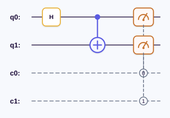

# QuSpect

*面向科研与教学的量子计算 SDK。*

[](https://pypi.org/project/quspect/)
[](https://python.org)
[](https://github.com/QuSpect/quspect/blob/main/LICENSE)
[](https://quspect.readthedocs.io/zh-cn/latest/)

> 🇬🇧 For English, see [README.md](README.md)

---

QuSpect 提供直观、流式的 Python API，用于构建量子线路、以 ASCII 图表或可缩放 SVG
进行可视化展示，以及态矢量演化与多次采样模拟。模拟和精确伴随梯度由 C++ 高性能
引擎提供支持。

---

## 目录

- [特性](#特性)
- [安装](#安装)
- [快速上手](#快速上手)
  - [构建量子线路](#构建量子线路)
  - [可视化](#可视化)
  - [模拟](#模拟)
  - [参数化线路](#参数化线路)
  - [变分目标与梯度](#变分目标与梯度)
  - [线路组合](#线路组合)
  - [算法示例](#算法示例)
  - [脉冲包络](#脉冲包络)
- [核心模块](#核心模块)
  - [QuantumCircuit 量子线路](#quantumcircuit-量子线路)
  - [Gate 量子门](#gate-量子门)
  - [DAG 中间表示与优化](#dag-中间表示与优化)
  - [Operator 算符](#operator-算符)
  - [IR 导出](#ir-导出)
- [可视化详解](#可视化详解)
  - [ASCII 文本图](#ascii-文本图)
  - [SVG 渲染](#svg-渲染)
  - [采样结果图表](#采样结果图表)
- [模拟引擎](#模拟引擎)
  - [后端无关的参数扫描](#后端无关的参数扫描)
- [云端 QPU](#云端-qpu)
  - [云端配置](#云端配置)
  - [真机运行](#真机运行)
  - [编译与物理比特布局](#编译与物理比特布局)
  - [异步与批量提交](#异步与批量提交)
- [C++ 原生后端](#c-原生后端)
- [文档](#文档)
- [开发](#开发)

---

## 特性

- **流式线路 API** — 方法链式构建线路，无需预先声明量子比特数量
- **24 个内置量子门模板** — 标准门（H、X、CX、CCX、SWAP…）、参数化旋转门（RX、RY、RZ、U3…），另支持测量与屏障
- **符号参数** — 用命名 `Parameter` 占位符定义变分线路，稍后绑定具体数值
- **DAG 编译器** — 将线路编译为 DAG 中间表示（IR），支持拓扑排序、分层划分与关键路径分析
- **优化通道** — `GateCancellation`（门消除）、`CommutationAnalysis`（交换分析）、`RotationMerging`（旋转合并）、`SingleQubitGateFusion`（单比特门融合）、`EliminateDiagonalBeforeMeasurement`（测量前对角门消除）
- **算符代数** — `QubitOperator`（泡利字符串）与 `FermionOperator`（粒子数表象产生/湮灭算符），支持 Jordan-Wigner 变换
- **态矢量模拟** — 原生 C++ 引擎提供高效的门作用、投影测量与多次采样
- **变分目标** — 通过统一的结构化 API 提供精确 C++ 伴随梯度和基于 shots 的参数移位梯度
- **可恢复批量执行** — 具名线路批次、扁平化参数扫描和不含凭据的任务引用
- **可视化** — ASCII 终端线路图、SVG 线路渲染（3 种主题）、采样结果图（hbar、vbar、dot、SVG）
- **IR 导出** — OpenQASM 2.0 与 QSAL（原生 JSON）导出
- **云端 QPU** — 通过统一 `Backend` 接口连接本地模拟器与 LogicalQubit、夸父 Quafu-SQC 真机
- **iSing 优化** — QUBO/Ising 模型转换、可恢复的云端提交与目标函数解码，需安装
  `quspect[isingq]`；参见 [iSing 云端优化](docs/source/isingq.rst)。
- **编译器** — 原生门分解、拓扑安全的 DAG 优化、受限物理比特 mapping，以及
  SABRE SWAP 路由；编译结果在所有平台（macOS、Linux x86_64/aarch64、Windows）上逐位一致，
  见[可复现的编译](docs/source/reproducibility.rst)
- **脉冲包络** — `quspect.pulse` 构建并解码超导量子比特控制包络（DRAG、平顶、自定义波形、
  边带混频、脉冲序列编排）；是 envelopes-qc 0.1.5 的 C++ 重新实现，输出逐位一致；参见
  [脉冲包络](docs/source/pulse.rst)
- **C++ 后端** — 高性能模拟和梯度引擎，支持 AVX2 SIMD 加速，通过 pybind11 桥接

---

## 安装

```bash
python -m pip install quspect
```

预编译的二进制 wheel 已包含 C++ 模拟引擎（启用 OpenMP），`pip install` 之后即可
直接使用 `Simulator`、`NativeExecutor` 和精确伴随梯度，无需编译器。

| 平台 | 架构 | Python | Wheel |
|------|------|--------|-------|
| Linux（glibc ≥ 2.28，如 Ubuntu 20.04+、RHEL/Rocky 8+、Debian 10+） | x86_64 | 3.10–3.15 | `manylinux_2_28_x86_64` |
| Windows 10/11 | x86_64（64 位 Python） | 3.10–3.15 | `win_amd64` |
| macOS 14（Sonoma）及以上 | Apple Silicon（arm64） | 3.10–3.15 | `macosx_14_0_arm64` |

- **Windows：** 64 位 CPython 3.10–3.15 无需任何额外安装——wheel 已自带 MSVC C++
  运行库和 OpenMP 运行库。
- **其他平台**（Linux aarch64、musl/Alpine、32 位 Windows、Intel Mac、
  macOS 14 以下、PyPy 等）会从源码包安装并现场编译 C++ 扩展。需要 CMake ≥ 3.22
  和 C++17 编译器——Windows 上为 Visual Studio Build Tools，macOS 上为 Xcode
  Command Line Tools（OpenMP 需另外 `brew install libomp`），Linux 上为 GCC 或
  Clang——并需要网络以获取 nlohmann/json。

运行时开关：

- 在 x86_64 上，若 CPU 支持 AVX2 + FMA，会自动选用 AVX2 内核；设置
  `QUSPECT_DISABLE_AVX2=1` 可强制使用可移植的标量内核（仅在首次调用原生模块时
  读取一次）。
- 并行内核基于 OpenMP；可通过 `OMP_NUM_THREADS` 限制线程数。

```bash
python -c "from quspect.native import capabilities; print(capabilities())"
```

开发安装（含 lint、类型检查、测试、文档工具）：

```bash
git clone https://github.com/QuSpect/quspect.git
cd quspect
python -m pip install -e ".[dev]"
python -m pip install pybind11
```

可编辑安装是纯 Python 的，不会编译 C++ 扩展；请按下文手动构建。

### C++ 原生后端

在源码仓库中使用 `Simulator`、`DensityMatrixSimulator`、`MonteCarloSimulator`、
`NativeExecutor` 或 `AdjointEngine` 前，请先构建原生扩展：

```bash
cmake -S cpp -B cpp/build -G Ninja \
  -DPython_EXECUTABLE="$(python -c 'import sys; print(sys.executable)')"
cmake --build cpp/build
ctest --test-dir cpp/build --output-on-failure
python -c "from quspect.native import capabilities; print(capabilities())"
```

依赖：C++17 编译器、CMake ≥ 3.22、Ninja、pybind11，以及可选的 AVX2 兼容
CPU。构建产物会写入本地 `quspect/` 包，因此上面的可编辑安装可以直接导入。
首次配置需要网络以获取 nlohmann/json；启用测试时还会获取 GoogleTest。
如果只需要标量实现，可传入 `-DQSPECT_BUILD_AVX2=OFF`。

维护者：wheel 的构建与 PyPI 发布流程见
[docs/source/releasing.rst](https://github.com/QuSpect/quspect/blob/main/docs/source/releasing.rst)。

---

## 快速上手

### 构建量子线路

```python
from quspect import QuantumCircuit

# 创建 Bell 态（量子纠缠）
circ = QuantumCircuit(name="bell")
circ.h(0)           # 在量子比特 0 上施加 Hadamard 门
circ.cx(0, 1)       # CNOT：控制=0，目标=1
circ.measure_all()  # 测量所有量子比特

print(circ.num_qubits)   # 2 — 自动推断
print(circ.num_clbits)   # 2
print(len(circ))         # 3 条指令
```

### 可视化

```python
# 终端 ASCII 线路图
print(circ.draw())
```

```python
# SVG 渲染（Jupyter 内联显示或保存为文件）
svg = circ.svg(style="dark")
svg.to_file("bell_circuit.svg")
```

`circ.svg()` 渲染的 Bell 线路（`"light"` / `"dark"` 主题，随 GitHub 配色自动切换）：

<picture>
  <source media="(prefers-color-scheme: dark)" srcset="https://raw.githubusercontent.com/QuSpect/quspect/main/docs/source/_static/readme/bell_circuit_dark.svg">
  
</picture>

### 模拟

```python
from quspect.simulation import Simulator

sim = Simulator(seed=42)
result = sim.run(circ, shots=1024)

print(result.counts)           # 约为 {'00': 512, '11': 512}
print(result.most_frequent())  # Bell 态的两个结果之一

# 统计摘要与柱状图
result.display(style="hbar")
```

### 参数化线路

```python
from quspect import QuantumCircuit, Parameter

theta, phi = Parameter("θ"), Parameter("φ")

circ = QuantumCircuit(name="variational")
circ.rx(theta, 0)
circ.ry(phi, 1)
circ.cx(0, 1)

# 模拟前绑定具体数值
bound = circ.bind_parameters({theta: 0.5, phi: 1.2})
```

### 变分目标与梯度

先定义一个不含测量的 ansatz 和具名观测量，再将同一个目标分别编译为精确伴随梯度
与有限 shots 的本地采样目标：

```python
from quspect import (
    AdjointEngine,
    ObservableObjective,
    Parameter,
    QuantumCircuit,
    QubitOperator,
    SamplingEngine,
    Simulator,
)

theta = Parameter("theta")
ansatz = QuantumCircuit(name="one_qubit_vqe").ry(theta, 0)  # 不添加测量
hamiltonian = QubitOperator({((0, "Z"),): 1.0})
objective = ObservableObjective(ansatz, {"energy": hamiltonian})

# 原生伴随引擎给出无噪声的精确值与梯度。
exact_plan = AdjointEngine(dtype="float64").compile(objective)
exact = exact_plan.evaluate({theta: 0.5})
print(exact.value("energy"), exact.derivative("energy"))
print(exact_plan.parameter_order)  # 优化器向量应遵循此参数顺序

# 同一目标通过分组测量和参数移位在本地模拟器上执行。
sampled_plan = SamplingEngine(
    Simulator(seed=7),
    shots=4096,
    grouping="qwc",
).compile(objective)
sampled = sampled_plan.evaluate({theta: 0.5})
print(sampled.value("energy"), sampled.derivative("energy"))
print(sampled_plan.num_measurement_groups)
print(sampled_plan.num_experiments_per_point)

# 不重新编译即可批量评估，且结果轴始终明确。
sweep = exact_plan.evaluate_many(
    [{theta: -0.2}, {theta: 0.0}, {theta: 0.2}]
)
print(sweep.values.shape)    # (3, 1)
print(sweep.jacobian.shape)  # (3, 1, 1)
```

有限 shots 的值与梯度会有统计波动，应与伴随结果按采样误差比较，而不是要求完全相等。
参数扫描、优化器接入、异步提交和任务恢复请参阅
[变分目标文档](docs/source/variational.rst)。

### 线路组合

```python
# 可复用的子线路
bell_pair = QuantumCircuit(name="bell")
bell_pair.h(0).cx(0, 1)

# 将子线路组合到大线路中
main = QuantumCircuit(name="composed")
main = main.compose(bell_pair, qubits=[0, 2])  # 映射子线路 0,1 → 主线路 0,2
main = main.compose(bell_pair, qubits=[1, 3])  # 映射子线路 0,1 → 主线路 1,3
```

### 算法示例

仓库中提供了可用经典方法核对结果的完整示例：

- [`examples/qaoa_max_cut.py`](examples/qaoa_max_cut.py) — 使用精确伴随梯度与
  SciPy BFGS 优化四节点 Max-Cut QAOA。
- [`examples/grover_long.py`](examples/grover_long.py) — 构造并模拟
  Grover–Long 精确搜索，包括匹配相位和辅助比特还原。
- [`examples/portfolio_selection.py`](examples/portfolio_selection.py) —
  通过完整的二次模型到 Ising 流程选择固定数量的均值—方差投资组合。
- [`examples/wireless_channel_assignment.py`](examples/wireless_channel_assignment.py)
  — 使用 one-hot 与成对干扰约束分配无线信道。

### 脉冲包络

`quspect.pulse` 用于组合控制包络，并在固定时间网格上采样（需要原生扩展，参见
[C++ 原生后端](#c-原生后端)）：

```python
import numpy as np
from quspect.pulse import GaussianDRAG, WaveCache, align, decode_envelope

pi_pulse = GaussianDRAG(t0=15, w=10, amp=1.0, coef=0.5, df=0.1, phase=0.0)
xy = align(pi_pulse, np.array([0.0, 50.0, 100.0]), np.array([1.0, 0.5, 1.0], dtype=np.float32))
t_start, wave = decode_envelope(xy, WaveCache(0.5), -50.0, 250.0)  # 0.5 ns 网格
print(t_start, wave.dtype, wave.shape)  # -50.0 complex64 (600,)
```

API 与 envelopes-qc 0.1.5（`envelopes.evc`）一致，解码出的波形逐位相同；全部包络类型参见
[脉冲包络](docs/source/pulse.rst)。
基于 envelopes-qc 编写的代码（例如 `lqcloud` 的脉冲序列）可以通过
`quspect.pulse.use_as_envelopes()` / `install_as_envelopes()` 直接运行在本实现上。

---

## 核心模块

### `QuantumCircuit` 量子线路

构建量子程序的核心类。量子比特与经典比特数量从使用的索引**自动推断**，无需预先声明线路规模。

| 方法 | 说明 |
|------|------|
| `.h(q)` `.x(q)` `.y(q)` `.z(q)` | 单量子比特门 |
| `.s(q)` `.sdg(q)` `.t(q)` `.tdg(q)` | 相位/旋转门 |
| `.rx(θ,q)` `.ry(θ,q)` `.rz(θ,q)` `.p(θ,q)` | 参数化旋转门 |
| `.cx(c,t)` `.cz(c,t)` `.swap(a,b)` | 两量子比特门 |
| `.ccx(c1,c2,t)` | Toffoli 门（控-控-X） |
| `.measure(qubits, clbits)` | 投影测量 |
| `.measure_all()` | 测量所有量子比特 |
| `.barrier(*qubits)` | 插入屏障 |
| `.compose(other, qubits, clbits, inplace=False)` | 组合另一个线路，默认返回副本 |
| `.bind_parameters({p: v})` | 绑定符号参数 |
| `.to_dag()` | 编译为 DAG 中间表示 |
| `.draw()` | ASCII 线路图 |
| `.svg(style, width, scale)` | SVG 线路图 |

### `Gate` 量子门

量子门是轻量元数据对象——存储名称、量子比特数及参数信息，但**不包含**酉矩阵。
需要矩阵时，请使用公开接口 `from quspect.gates import gate_matrix`。

```python
from quspect.gates.standard import H, CX, CCX, SWAP
from quspect.gates.parameterized import RX, RY, RZ, U3

# 标准门是模块级单例
circ = QuantumCircuit()
circ.append(H, [0])
circ.append(CX, [0, 1])
circ.append(CCX, [0, 1, 2])

# 参数化门 — 通过 `.with_params()` 创建具体实例
gate_ry = RY.with_params(0.5)
circ.append(gate_ry, [1])
```

### DAG 中间表示与优化

线路可编译为**有向无环图**（DAG），清晰展示量子比特与经典比特之间的依赖关系：

```python
dag = circ.to_dag()

print(dag.num_nodes(), dag.num_edges())
print(dag.topological_order())    # 拓扑排序
print(dag.layers())               # 划分为并行层
print(dag.critical_path_length()) # 最长路径上的操作数
```

使用 `PassManager` 在 DAG 上执行优化通道：

```python
from quspect import PassManager, GateCancellation, RotationMerging

pm = PassManager([
    GateCancellation(),     # 门消除
    RotationMerging(),      # 旋转合并
])
optimized = pm.run(dag)
```

### `Operator` 算符

支持二次量子化算符代数：

```python
from quspect import FermionOperator, QubitOperator
from quspect.operators.transforms import jordan_wigner

# 泡利字符串算符
H = QubitOperator({
    ((0, "X"), (1, "X")): 1.0,
    ((0, "Z"),): -0.5,
})

# 费米子算符（产生/湮灭算符）
f = FermionOperator({((2, 1), (1, 1), (0, 0), (3, 0)): 2.0})

# Jordan-Wigner 变换：费米子 → 量子比特
qubit_op = jordan_wigner(f)
```

### IR 导出

```python
from quspect.ir import QASM2ExportConfig, QASM2Exporter, QASM2ExportMode
from quspect.ir.qsal import dumps as qsal_dumps

# OpenQASM 2.0 导出
print(QASM2Exporter().export(circ))  # 严格模式

config = QASM2ExportConfig(mode=QASM2ExportMode.DECOMPOSE)
print(QASM2Exporter(config).export(circ))

config = QASM2ExportConfig(mode=QASM2ExportMode.EXTENDED)
print(QASM2Exporter(config).export(circ))

# QSAL（原生 JSON 中间表示）
print(qsal_dumps(circ))
```

---

## 可视化详解

### ASCII 文本图

零依赖终端线路图，通过 `circuit.draw()` 获取：

- 量子线 `-`，经典线 `=`
- 量子门标签 `[方括号]`，控制点 `o`，目标位标注门名
- SWAP 门以 `x` 标记垂直相连
- 屏障线 `|`

### SVG 渲染

通过 `circuit.svg()` 生成可缩放矢量图形，支持 Jupyter Notebook 内联显示：

```python
svg = circ.svg(style="dark", width=600, scale=1.2)
print(svg)                # SVG 字符串
svg.to_file("out.svg")    # 保存到文件
```

**三种内置主题：**

| 主题 | 背景 | 适用场景 |
|------|------|---------|
| `"official"` | 白色，石板色文字 | 论文、出版物 |
| `"light"` | 冷灰色 | 浅色 IDE、文档 |
| `"dark"` | 深海军蓝 | 深色 Notebook、演示幻灯片 |

**自定义主题：**

```python
from quspect.visualization import SvgStyle, draw_svg_circuit

custom = SvgStyle(
    background="#1a1a2e",
    wire="#e94560",
    classical_wire="#8892a8",
    gate_fill="#0f3460",
    gate_stroke="#16213e",
    text="#ffffff",
    control="#e94560",
    barrier="#8892a8",
    measure_fill="#53354a",
    channel_fill="#3a2f52",
    channel_stroke="#f0a500",
)
svg = draw_svg_circuit(circ, style=custom)
```

### 采样结果图表

结果可视化附带统计标注：

```python
result.display(style="hbar", sort_mode="count_desc")
```

四种图表样式：`hbar`（水平柱状图）、`vbar`（垂直柱状图）、`dot`（点图）、`svg`。

并排对比视图：

```python
from quspect.visualization import compare_results

compare_results(result1, result2, label_a="Ideal", label_b="Noisy")
```

---

## 模拟引擎

`Simulator` 实现了 `Backend` 抽象接口，并将态矢量演化交给 C++ 原生引擎：

```python
from quspect import QuantumCircuit
from quspect.simulation import Simulator

sim = Simulator(seed=42)          # 设置随机种子以保证采样可复现

# 无测量线路：保存最终态矢量
state_circ = QuantumCircuit(name="bell_state").h(0).cx(0, 1)
state_result = sim.run(state_circ, save_statevector=True)
print(state_result.statevector)

# 含测量线路：基于多次采样的投影测量
sampled_circ = state_circ.copy().measure_all()
result = sim.run(sampled_circ, shots=4096)

# 获取结果
print(result.counts)              # 约为 {'00': 2048, '11': 2048}
print(result.probabilities)       # 约为 {'00': 0.5, '11': 0.5}
print(result.most_frequent())     # Bell 态的两个结果之一
print(result.top_outcomes(3))     # 前 3 个最常见结果
```

**测量模式：**

- **末尾测量** — 所有 `measure` 操作位于线路末尾：仅演化一次，然后采样
- **中间测量** — 测量与门操作交错排列：每次采样独立重新执行，每次测量后坍缩状态

### 后端无关的参数扫描

`ExecutionRequest.sweep()` 会快照一个参数化模板，并按输入顺序绑定每个参数点。
同一个具名请求可交给本地模拟器或支持批量的云后端：

```python
import math

from quspect import ExecutionRequest, Parameter, QuantumCircuit, Simulator

theta = Parameter("theta")
template = QuantumCircuit().ry(theta, 0).measure_all()
request = ExecutionRequest.sweep(
    template,
    [{theta: 0.0}, {theta: math.pi}],
    labels=["zero", "one"],
    shots=128,
)

batch = Simulator(seed=7).execute(request)
print(batch.by_label("zero").counts)  # {'0': 128}
print(batch.by_label("one").counts)   # {'1': 128}
```

---

## 云端 QPU

QuSpect 通过统一的 `Backend` 接口连接本地模拟器和云端真机。目前支持
LogicalQubit、夸父 Quafu-SQC、本源量子（Origin Quantum）与天衍（Tianyan）平台。

### 云端配置

```bash
export LQCLOUD_API_KEY=qk_your_api_key_here
pip install "quspect[logicalqubit]"
```

该 extra 安装 lqcloud 0.6，它只发布了 Python 3.11 与 3.12 的版本。自 lqcloud 0.6
起，`LQCLOUD_API_KEY` / `LQCLOUD_TOKEN` / `LQCLOUD_URL` 环境变量优先于传给
`LogicalQubitProvider(...)` 的参数；显式参数因此被忽略时 QuSpect 会给出警告。
lqcloud 0.6 还默认开启本地任务库（在 `~/.lqcloud/store` 下保存提交的线路与取回的
结果，上限 2 GB），可用 `LogicalQubitProvider(store=False)` 或 `LQCLOUD_STORE=0`
关闭。

开启 `readout_correction=True` 时结果遵循 lqcloud 0.6 的语义：`result.counts`
（以及 `result.memory`）是原始测量结果，`result.probabilities` 是服务端矫正后的
分布（`SamplingEngine` 使用的就是它），`result.metadata["quasi_counts"]` 保存其
未取整的「概率 × shots」值。

### 真机运行

以下调用会创建真实任务，可能消耗额度。提交前请使用
`provider.list_backends()` 查看当前账号可见的设备及其拓扑。

```python
from quspect import QuantumCircuit
from quspect.backends.logicalqubit import LogicalQubitProvider

provider = LogicalQubitProvider()
backend = provider.get_backend("QZ02")

qc = QuantumCircuit(name="bell")
qc.h(0).cx(0, 1).measure_all()

result = backend.run(qc, shots=2000)
print(result.counts)
```

### 编译与物理比特布局

默认的 `transpile=True` 用 `quspect.transpiler.transpile()`（默认优化级别、固定随机种子）
为目标设备编译线路，真机运行与你在代码里调用的是同一个编译器：分解到芯片原生门、
在耦合图上做布局与路由，并在路由之后继续优化。线路末尾的测量保持在末尾，每个经典
比特读取的是路由结束时承载对应逻辑比特的物理比特。

`transpile()` 不处理的线路仍走下面的流程：含中途测量的线路、门之间有 barrier 的线路
（barrier 仍然阻止跨越它的优化）、设备上报的门集不构成完备门集的情况，以及双比特门
超过 200 个的线路（编译时间）。

1. 将非原生门递归分解为芯片原生门；
2. 在物理路由前执行与拓扑无关的门消除、交换分析、旋转合并和单比特门融合；
3. 使用 SABRE 选择逻辑到物理比特的 mapping，并插入满足 coupling topology
   的 SWAP。

未指定 `physical_qubits` 和 `initial_layout` 时，如果芯片公布了标定数据（后端
config 中的 `coupler_metrics[].cz_fidelity`、`qubit_metrics[].measure_f0/measure_f1`），
布局会按标定选位：QuSpect 分别在整块芯片和标定最好的连通区域（与线路同样大小、
以及多两个比特）上编译，提交所用两比特门与读出保真度乘积最高的那份程序。
估计值相同时保留整块芯片上的结果；没有标定数据的芯片仍只按拓扑布局，与此前一致。

如果标定结果表明部分物理比特质量更好，可用 `physical_qubits` 将 mapping 和
所有路由 SWAP 限制在这些比特形成的诱导子图内：

```python
qc = QuantumCircuit(name="calibrated_subset")
qc.h(0)
qc.cx(0, 1).cx(0, 2).cx(0, 3)
qc.measure_all()

# 仅限定可用物理比特池，由 SABRE 在池内选择初始 mapping。
job = backend.submit(
    qc,
    shots=1000,
    transpile=True,
    physical_qubits=[7, 8, 9, 10, 11],
)

# 同时固定起始映射：
# 逻辑 q0→物理 7，q1→8，q2→9，q3→10。
job = backend.submit(
    qc,
    shots=1000,
    transpile=True,
    physical_qubits=[7, 8, 9, 10, 11],
    initial_layout=[7, 8, 9, 10],
)
```

`physical_qubits` 必须无重复、不越界、数量足够，并在设备 coupling map 上形成
连通子图。如果同时提供 `initial_layout`，其中每个物理比特都必须属于
`physical_qubits`。路由可以从该池中增加 workspace wire，QuSpect 会将路由后
线路所需的完整逻辑→物理 layout 交给 LQCloud。

如果线路已经完成编译并满足目标拓扑，可关闭 QuSpect 编译；此时
`initial_layout` 直接透传给 provider，且不能再提供 `physical_qubits`：

```python
result = backend.run(
    qc,
    shots=1000,
    transpile=False,
    initial_layout=[7, 8, 9, 10],
)
```

路由过程会保留原线路的经典测量目标和静态 provider layout。DAG 优化会在多比特
门涉及的每一根 wire 上检查相邻关系，因此不会错误消除 QAOA ZZ 相位实现中的
`CX–RZ(target)–CX`。

### 异步与批量提交

```python
# 异步单线路任务
job = backend.submit(qc, shots=2000)
print(job.job_id, job.status().value)
result = job.result(timeout=600)

# 具名批量任务
from quspect import ExecutionRequest

request = ExecutionRequest.batch(
    [circuit_a, circuit_b],
    labels=["theta-plus", "theta-minus"],
    shots=2000,
    options={
        "transpile": True,
        "physical_qubits": [7, 8, 9, 10, 11],
    },
)
batch_job = backend.submit_request(request)
batch = batch_job.result(timeout=600)
print(batch.by_label("theta-plus").counts)
```

任务的 `job.reference` 不包含凭据，可序列化保存并通过
`LogicalQubitProvider.retrieve_job()` 恢复。批量任务超过 provider 单批上限时，
QuSpect 会返回可恢复的组合任务；部分提交失败时可从
`PartialSubmissionError` 获取已创建的任务引用。

### 夸父 Quafu-SQC

[夸父 Quafu-SQC](https://quafu-sqc.baqis.ac.cn) 是北京量子院的超导量子计算云。
QuSpect 直接用 Python 标准库调用其 HTTP 接口，**无需安装夸父 SDK**；`quafu` extra 仅为与其他平台保持一致，
不会安装任何依赖（`pip install "quspect[quafu]"`）。
在 SQCLab 网站获取 token（有效期 30 天）后，可通过 `QuafuProvider(token=...)`、
环境变量 `QUAFU_API_TOKEN`（或 SDK 使用的 `QPU_API_TOKEN`），或 JSON 文件
`~/.quafu/api`（内容为 `{"token": "..."}`）提供。

```python
from quspect import QuantumCircuit
from quspect.backends.quafu import QuafuProvider

provider = QuafuProvider()
print(provider.token_expiry)
print(provider.list_backends())  # {'Haituo': 0, 'Baihua': 12, 'Ling': 'Calibrating', ...}

backend = provider.get_backend("Haituo")
print(backend.num_qubits, backend.native_gate_set, backend.calibration_time)

qc = QuantumCircuit(name="bell")
qc.h(0)
qc.cx(0, 1)
qc.measure([0, 1], [0, 1])
result = backend.run(qc, shots=1024)
print(result.counts)                       # {'00': ..., '11': ...}
print(result.metadata["executed_qasm"])    # 芯片上实际执行的物理线路
```

工作方式：

- **编译由 QuSpect 完成。** 芯片公开的标定数据（`/task/backendtest/{chip}1`）提供
  基础门集（`h, rx, ry, rz, cz`）和耦合图；标定保真度为 0 的耦合器和比特会被剔除。
  线路经分解、优化后，用 SABRE 映射到夸父按保真度推荐的 `priority_qubits`
  中最小的连通子集上，再关闭服务端编译器提交，芯片按提交的物理线路原样执行。
- **超出夸父推荐范围时，按标定数据选位。** 没有任何 `priority_qubits` 子集能容纳
  线路时，QuSpect 会分别在整块可用芯片和标定最好的连通区域（与线路同样大小、
  以及多两个比特）上编译，提交 CZ、单比特门与读出保真度乘积最高的那份程序。
  估计值相同时保留整块芯片上的结果，所以标定平坦的芯片不会改变布局，除非某个
  区域能省门。
- `physical_qubits=[...]` / `initial_layout=[...]` 约束比特布局；`transpile=False`
  表示线路下标已是物理比特（本地会校验耦合）。
- `server_compiler="quarkcircuit" | "qiskit" | "qsteed"`（需 `transpile=False`）
  改由夸父服务端编译。
- `readout_correction=True` 返回夸父读出纠错后的准概率：`counts` 保持原始计数，
  `probabilities` 为截断并归一化后的分布，原始准概率在
  `metadata["quasi_probabilities"]`。
- `dynamic_decoupling="XY4" | "CPMG"` 开启动力学解耦。
- shots 以 1024 为单位执行，其他值会向上取整。
- 比特串采用 QuSpect 约定（第 *i* 个字符对应经典比特 *i*，未测量的比特为 `0`），
  已从夸父的小端键转换。
- 每条线路对应一个夸父任务；批量提交返回可恢复的 `CompositeJob`，可用
  `provider.retrieve_job(job.reference)` 或
  `provider.retrieve_job(task_id, backend_name="Haituo")` 重新获取。
- 读取任务：结果尚不可用时，`job.result(timeout=...)` 抛出 `JobTimeoutError`
  （`exc.result_pending` 为 `True`）；任务失败、已取消、夸父查不到该任务
  （`error_type == "not_found"`）或结果无法解码时，抛出普通的 `JobError`
  （`result_pending` 为 `False`）。`job.cancel()` 返回夸父是否确认了取消请求；
  `job.provider_status()` 返回夸父原始的状态文本。

### 本源量子（Origin Quantum）

```bash
export QPANDA_QCLOUD_API_KEY=...   # 本源量子云控制台获取
```

无需安装额外依赖：QuSpect 用标准库直接调用本源云平台的 HTTP 接口，并自行生成
OriginIR，不依赖 pyqpanda3，QuSpect 支持的平台都能使用。该接口即 pyqpanda3
0.5.1 所用接口，没有公开文档；测试会比对 QuSpect 与 SDK 发出的请求，以便及时
发现协议变化。当前 key 内嵌的服务地址是明文 `http`，key 以明文传输（与
pyqpanda3 相同）。

```python
from quspect.backends.originq import OriginQProvider

provider = OriginQProvider()
backend = provider.get_backend("full_amplitude")   # 云模拟器；真机如 "WK_C180_2"
result = backend.run(qc, shots=2000)
```

- **比特顺序**：结果按 QuSpect 约定（经典比特 0 在最左）。本源的结果为小端，
  且按被测量子比特排列（忽略 `MEASURE` 的经典比特参数；测量不按
  比特升序时会解码错误）。因此 QuSpect 在末尾按比特升序对每个被测比特只测量
  一次，再用任务引用中保存的测量映射还原经典比特。仅支持末端测量。
- **编译**：`transpile=True`（默认）时由 QuSpect 编译到 `{cz, u3, rz}`，在芯片
  校准数据最好的连通区域（按单比特门×读出保真度及 CZ 保真度挑选，或用
  `physical_qubits=[...]` 指定）上做 SABRE 映射与路由，并关闭云端映射提交。
  校准数据很重要：`WK_C180` 编号靠前的几个比特校准失败或读出很差，用它们得到的
  结果是错的；`transpile=False` 时由本源云端做映射
  （`provider_mapping=True`）。`readout_correction` 对应云端的 amend 选项（默认开）。
- **结果**：本源返回概率，`result.probabilities` 为云端分布，`result.counts`
  按最大余数法把 shots 分配到各结果，计数之和等于 shots
  （`metadata["counts_source"] == "probabilities"`）。读出纠错产生的负值会被截断
  并重新归一化，云端的原始值保留在 `metadata["quasi_probabilities"]`。
- `full_amplitude` 模拟器不接受选项也不支持原生批量，请求会拆成每个线路一个任务；
  任务不可取消。真机 shots 上限由芯片的 `MaxShots` 决定（`WK_C180_2` 为 49600）。
- 格式错误的程序不会被云端拒绝，任务会一直停在计算中，因此调用 `result()` 时
  请务必传 `timeout`。

### 天衍（Tianyan）

[天衍](https://qc.zdxlz.com)是中电信量子集团的量子计算云平台。QuSpect 自行生成
QCIS，并用标准库直接调用云平台的 HTTPS 接口，**无需安装 cqlib**。

```bash
export TIANYAN_LOGIN_KEY=...   # qc.zdxlz.com 个人中心的 API Token
```

```python
from quspect.backends.tianyan import TianyanProvider

provider = TianyanProvider()
backend = provider.get_backend("tianyan176")    # 真机；"tianyan_sw" 为全振幅模拟器
result = backend.run(qc, shots=2000)
```

- **编译与比特映射全部由 QuSpect 完成**：云端不做映射和路由，在不相连的比特上
  做 `CZ` 或使用被禁用的比特都会被拒绝。`transpile=True`（默认）时 QuSpect 把
  电路分解到 QCIS 门集，并在已启用比特和耦合器中校准数据最好的连通区域（或
  `physical_qubits=[...]` 指定的比特）上做 SABRE 映射与路由；`transpile=False`
  时按电路里的比特号直接作为物理比特提交。
- **比特顺序**：结果按 QuSpect 约定。天衍按 `M` 指令顺序报告被测比特和每个
  shot，`probability` 的键则是最先测量的比特在最右边。QuSpect 在末尾按比特升序
  对每个被测比特只测量一次，再用任务引用中保存的测量映射还原经典比特。仅支持
  末端测量。
- **结果**：`result.counts` 为实测 shot 计数；`result.probabilities` 在天衍提供时
  使用其分布（真机上为读出校正后的结果，见 `metadata["probabilities_source"]`）。
- **批量**：真机原生批量要求每个程序测量相同的比特，因此请求会按测量比特分组
  （每组最多 49 个程序），整体作为一个可恢复的任务返回。
- 网关经常返回 HTTP 504。读请求会自动重试，提交也会重试（`submit_retries`，
  默认 3 次）：超时的提交可能已经建了任务，所以重试偶尔会多出一份重复任务，
  每次重试都会记一条 warning。付费机器上在意的话，可以用
  `TianyanProvider(submit_retries=0)`。

---

## C++ 原生后端

C++ 后端（`cpp/`）为模拟和伴随梯度提供高性能原生引擎：

```
cpp/
├── include/quspect_native/    # 公共头文件
├── src/
│   ├── kernels/scalar/        # 可移植标量核心
│   ├── kernels/avx2/          # SIMD 加速核心（AVX2）
│   ├── kernels/dispatch/      # 运行时 CPU 特性分发
│   ├── runtime/               # StateVector, ClassicalRegister, RuntimeEngine
│   ├── ir/                    # QSAL JSON 解码 & Program 构建
│   ├── executor/              # SimulationExecutor、GradientExecutor
│   └── pybind/                # Python → C++ 桥接（pybind11）
└── tests/                     # GoogleTest 套件（14 个测试文件）
```

**Python 桥接：**

```python
from quspect import QuantumCircuit
from quspect.ir.qsal import dumps as qsal_dumps
from quspect.native import NativeExecutor

qc = QuantumCircuit().h(0).measure_all()
executor = NativeExecutor()
result = executor.run(qsal_dumps(qc), shots=1024)
print(result.counts)
```

若原生模块未构建，线路构建等 Python 工具仍可使用，但依赖原生引擎的
入口会抛出 `NativeImportError`。

---

## 文档

完整文档托管于 Read the Docs：[中文文档](https://quspect.readthedocs.io/zh-cn/latest/)（英文版：[quspect.readthedocs.io/en/latest/](https://quspect.readthedocs.io/en/latest/)）：

- **[快速上手](https://quspect.readthedocs.io/zh-cn/latest/quickstart.html)** — 安装、线路构建、模拟
- **[API 参考](https://quspect.readthedocs.io/zh-cn/latest/api.html)** — 当前已列出公开模块的生成文档
- **[架构设计](https://quspect.readthedocs.io/zh-cn/latest/architecture.html)** — 分层架构、核心概念、设计决策

本地构建文档（文档直接导入源码树，无需编译 C++ 扩展）：

```bash
python -m pip install -r docs/requirements.txt
cd docs
sphinx-build -b html source/ build/html/
sphinx-build -b html -D language=zh_CN source/ build/html/zh_CN/
```

---

## 开发

```bash
# 代码检查与格式化
ruff check quspect/ tests/ && ruff format quspect/ tests/

# 类型检查
mypy quspect/

# 运行测试
pytest

# 在仓库根目录构建 C++ 后端并运行 gtest
cmake -S cpp -B cpp/build -G Ninja && cmake --build cpp/build
ctest --test-dir cpp/build --output-on-failure
```

### 工具链

| 工具 | 用途 |
|------|------|
| `ruff` | 代码检查与格式化 |
| `mypy` | 静态类型检查（严格模式） |
| `pytest` + `pytest-cov` | 测试与覆盖率 |
| `sphinx` | 文档生成 |
| `cmake` + `ninja` | C++ 构建系统 |
| `gtest` | C++ 单元测试 |
