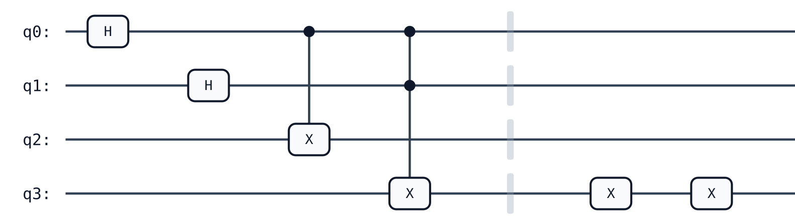
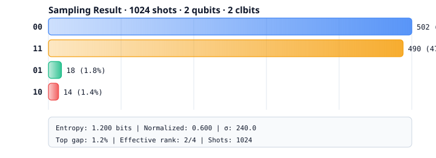

QuSpect Documentation
=====================

QuSpect is a quantum computing SDK for research and education. It provides
an intuitive Python API for constructing quantum circuits, building DAG-based
intermediate representations, and preparing for simulation and hardware execution.

   A 4-qubit quantum circuit showcasing single-qubit gates (H, X, T), two-qubit
   gates (CNOT), three-qubit gate (CCX/Toffoli), SWAP, barrier, and
   measurement, rendered as a scalable SVG diagram.

   Measurement sampling result from a Bell state circuit (1024 shots),
   displaying outcome distribution as a gradient bar chart with built-in
   statistical annotations (entropy, variance, top-gap, effective rank).

.. toctree::
   :maxdepth: 2
   :caption: Contents:

   installation
   quickstart
   variational
   optimization
   optimization_applications
   ising_solver
   isingq
   pulse
   api
   architecture
   releasing

Indices and tables
==================

* :ref:`genindex`
* :ref:`modindex`
* :ref:`search`
